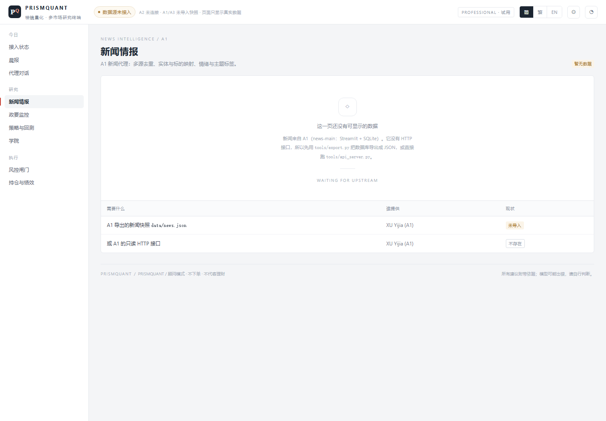

# PrismQuant · 棱镜量化 — Web Client

[繁體中文](README.md) · **English**

Front-end for **PrismQuant**, a multi-market, medium-to-low-frequency quantitative
research and multi-agent decision platform.

Built for **ITE4116M Final Year Project · Systems Development and Administration**,
IVE / HKIIT, Group 1.

The client turns the output of five specialist agents — news, political monitoring,
execution, risk control and a commander — into one morning briefing a subscriber can
read in ten minutes and act on with three clicks.

> **Advisory mode only.** The product never routes orders. Live execution is off by
> default and the demo environment uses simulated matching.

---

## Screenshots

**Integration status (landing page)** — what each of the five agents has, and what it is missing.


| Political watch · live backend | News · no snapshot imported |
|---|---|
|  |  |

More in [`screenshots/`](screenshots).

## Modules

| Module | Agent | Contents |
|---|---|---|
| Morning briefing | A5 | Four KPI cards, the briefing text, four execution intents, overnight timeline, agent status, risk-gate summary, dissenting views |
| News intelligence | A1 | Event clusters (not a feed), dedup rate, sentiment / topic tags, sources, pipeline, known limits |
| Political watch | A2 | People → statements → full text, attribution badges, live collection status. **Connected to a real backend.** |
| Strategy & backtest | A3 | NAV vs benchmark, drawdown, monthly returns, strategy families, parameters, return attribution |
| Risk gates | A4 | Gate chain, six limits with utilisation, veto log, pause / emergency flatten |
| Commander | A5 | Dialogue with an expandable evidence chain, run metadata, citations |
| Portfolio | F-09 | Positions, P&L, market exposure, contribution by agent |
| Academy | — | Four educational articles |

Plus sign-in with plan quotas, `简 / 繁 / EN` switching, responsive layout
(390 / 820 / 1180 / 1400 breakpoints), keyboard focus rings and a PWA manifest.

---

## How it is built

```
                    ┌──────────────────────────────┐
  index.html  ────► │  app shell (topbar, nav)     │
  (single file)     │  hash router  #/briefing …   │
                    ├──────────────────────────────┤
                    │  view*() → HTML string       │
                    │  render() replaces #view     │
                    ├──────────────────────────────┤
                    │  data layer                  │
                    │   D      sample fixtures     │
                    │   A2     live fetch client ──┼──► FastAPI  /api/v1/*
                    └──────────────────────────────┘
```

**One file, no build.** The whole client is `index.html`: markup, CSS and ES2020 in
a single document. No bundler, no framework, no runtime dependencies, no CDN, no
external fonts — it runs from `file://` and from any static host.

**Rendering.** A hash router maps `#/route` to a `view*()` function that returns an
HTML string; `render()` swaps the contents of `#view`. State lives in a few module
level objects (`A2` for the API, `STRAT` / `NEWS_FILTER` / `ACAD` for view state).
Interaction is handled by one delegated `click` listener on `document`.

**Charts are hand-written SVG.** `navSvg()`, `ddSvg()` and `heatSvg()` compute their
own coordinates, so the geometry is testable and nothing loads at runtime. The NAV,
drawdown, Sharpe and volatility figures all derive from the same series
(`statsOf()`), so they cannot disagree with each other.

**The API client** mirrors the contract in the A2 backend's `FRONTEND_INTEGRATION.md`:
opaque cursors, `order=published_desc`, request cancellation by incrementing `reqId`
when the selected person changes, 404 / 422 / 503 mapped to distinct messages, and
plain-text rendering of `body_text` with line breaks preserved.

**Three languages.** Simplified and English are separate dictionaries. Traditional is
not a third dictionary — it is converted at runtime from a lookup table generated with
OpenCC (`s2hk`): 294 character pairs plus 64 phrases for one-to-many cases such as
干預 / 乾淨 / 幹部. A `MutationObserver` converts text nodes and
`placeholder / title / aria-label` as they appear, so dynamic content (load more,
chat replies, toasts) is covered, and data content is converted too — no
"traditional chrome, simplified content" split.

**Type scale is seven steps** (26 / 22 / 18 / 15 / 13 / 12 / 11 / 10). Nothing lands
between steps; CJK body text is capped at `40em` (≈ 33–38 characters per line).

**PWA.** `manifest.webmanifest` + `sw.js` (network-first, so a deploy is picked up on
the next load). Installable and works offline, over `http(s)` only.

---

## Run it

### Just look at it
Double-click `index.html`. Everything renders with sample data, and the header says so.

### With the real political-monitoring API
Start the A2 service (separate FastAPI project), allow this origin, then restart it:

```dotenv
PQ_CORS_ORIGINS='["http://localhost:5173"]'
```

Double-click `start-frontend.cmd` — it serves this folder on port 5173, opens the
browser and points the client at `http://127.0.0.1:8000`.

### Mount inside the API (same origin, no CORS)
Copy `index.html` into the backend as `web/index.html`, then in `app/main.py`:

```python
application.mount("/app", StaticFiles(directory=PROJECT_ROOT / "web", html=True), name="app")
```

Open `http://127.0.0.1:8000/app/`.

### GitHub Pages
Push this repository, then **Settings → Pages → Source: `main` / `/ (root)`**.
The site is served at `https://<user>.github.io/<repo>/`.

---

## What each page shows

This build shows **only real data**. A page with no upstream connection shows an empty
state that names what is missing — no invented NAV, positions, limits or headlines.

| Page | Source | Without data |
|---|---|---|
| Status | runtime state of the five agents | — |
| Briefing | one A5 run | empty state |
| News | `data/news.json` or `tools/api_server.py` | empty state + export command |
| Political watch | A2 `/api/v1/*` (live) | empty state, no sample statements |
| Strategy | `data/backtests.json` | empty state + export command |
| Risk gates | A4 engine | always empty (A4 has no code) |
| Commander | A5 endpoint | always empty (A5 has no code) |
| Portfolio | simulated account | empty state |
| Academy | four articles (authored content) | — |

## Known gaps

1. **Five of the nine pages are empty right now**: A1 needs one collection export,
   A2 needs its backend plus a collection run, A3 needs a backtest (missing 5-minute
   bars and quote quota), A4 and A5 have no runnable code. Export paths are ready
   (`tools/export.py`, `tools/api_server.py`).
2. **The A2 integration was verified against a contract stub, not production.** The
   stub (`src/stub_api.py`) mirrors the documented response shapes; the real database
   has never been reachable from the development machine.
3. **No authentication.** Sign-in, quotas and the subscription tier are presentational;
   there is no session, no token, no permission check.
4. **Charts have no hover interaction** — no tooltip, no crosshair, no zoom.
5. **Accessibility is partial.** Landmarks, `aria-pressed`, visible focus rings and
   text labels for every risk state are in place; tables lack `scope`, and
   `prefers-reduced-motion` is not handled.
6. **PWA is minimal** — installable and offline-capable, but no background sync or push.
7. **Traditional conversion is corpus-bound.** The phrase table was generated from the
   current copy; new strings containing one-to-many characters (后/後, 发/髮) may
   convert wrongly until the table is regenerated.
8. **i18n covers the interface, not the data.** News headlines and article bodies stay
   in their source language, which is normal for a research terminal but does mean the
   English UI still shows Chinese content.

---

## Roadmap

**Phase 1 — close the loop (semester 1)**
- Publish `/api/v1/news/events` from A1 and `/api/v1/strategy/backtests` from A3;
  replace the fixtures with fetches in `viewNews()` and `viewStrategy()`.
- Stand up the A2 PostgreSQL instance and re-run the integration checklist against it.
- Replace the canned Commander replies with a real orchestration endpoint
  (`POST /api/v1/commander/run`), keeping the evidence-chain rendering as is.

**Phase 2 — productisation**
- Session-based sign-in, tier enforcement, and quota counters fed by the API.
- Alerts: an in-app drawer, email and Telegram, with per-tier routing.
- Chart interaction: crosshair, tooltip, range selector, export to CSV.
- Real-time updates via SSE for briefs and risk events (the contract already forbids
  WebSocket-only designs for the demo environment).

**Phase 3 — engineering**
- Split the single file into ES modules and add a build step *only if* the file size
  becomes a maintenance problem (it is 150 KB today; that is not a problem yet).
- Automated browser tests: route smoke tests, i18n snapshots, a11y assertions.
- Move the design tokens into CSS custom properties and generate a dark theme from them.
- Bundle a small OpenCC runtime so the Traditional table is generated at build time
  rather than committed.

**Deliberately not planned**
- High-frequency or order-book views — out of scope in the proposal.
- Native iOS/Android — the PWA covers the requirement for this stage.

---

## Repository layout

```
.
├── index.html              the entire client (generated — edit src/, not this)
├── manifest.webmanifest    PWA manifest
├── sw.js                   service worker (network first)
├── icon.svg                app icon (SVG, so it stays text)
├── start-frontend.cmd      local preview server (Windows)
├── docs/
│   ├── DESIGN.zh.md        design specification — IA, type scale, i18n, states
│   └── INTEGRATION.zh.md   integration guide — CORS, mounting, data provenance
├── screenshots/            desktop, mobile, three languages
├── data/                   snapshots (empty by default -> fixtures)
├── tools/export.py         A1 / A3 exporters
└── src/
    ├── build.py            concatenates p*.html / p*.js into index.html
    ├── p1_head.html        head + design tokens + all CSS
    ├── p2_body.html        static shell + sign-in screen
    ├── p0_hant.js          Simplified → Traditional lookup (generated, OpenCC s2hk)
    ├── p3_data.js          i18n dictionaries, helpers, sample fixtures
    ├── p4a_views.js        charts, briefing, news
    ├── p4b_*.js            political watch (live), strategy
    ├── p4c_*.js            risk, commander, portfolio, academy
    ├── p5_boot.js          shell render, router, API client, events, boot
    └── stub_api.py         contract stub used for integration testing
```

Rebuild after editing `src/`:

```bash
python src/build.py            # rebuild + screenshot all routes
python src/build.py briefing   # rebuild + one route
```

`build.py` also runs `node --check` on every script block and fails loudly on a
syntax error — that is the only "test" in the project, and it has caught more bugs
than any other tool here.

---

## Team

ITE4116M Group 1

| Name | Student ID | Role in this repository |
|---|---|---|
| LIU Tsz Ho | 250139930 | Front-end architecture, implementation, API integration |
| XU Yijia | 250050253 | Platform & risk; A2 backend |
| AU Ka Chai | 250111797 | Project management; A5 commander |
| XU Jinrong | 250500730 | Quant & strategy; A3 execution |

The political-monitoring service (`/api/v1/*`) is XU Yijia's work and lives in a
separate repository. This repository contains only the web client.
