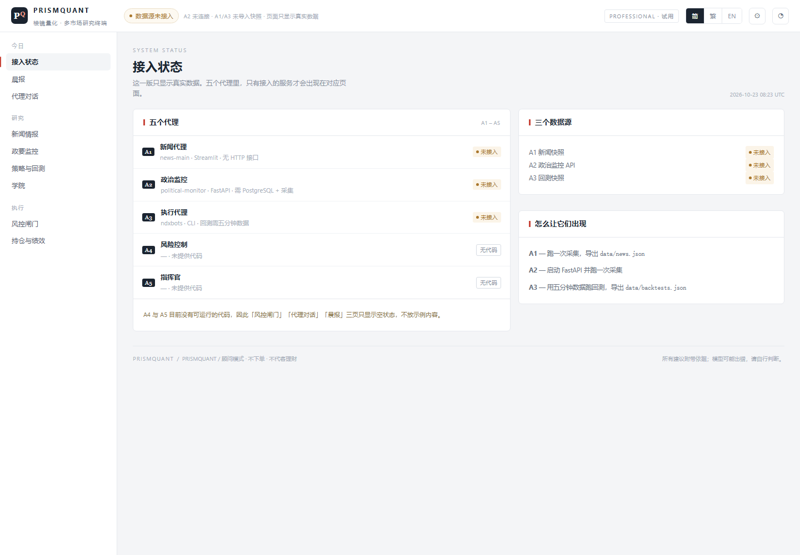
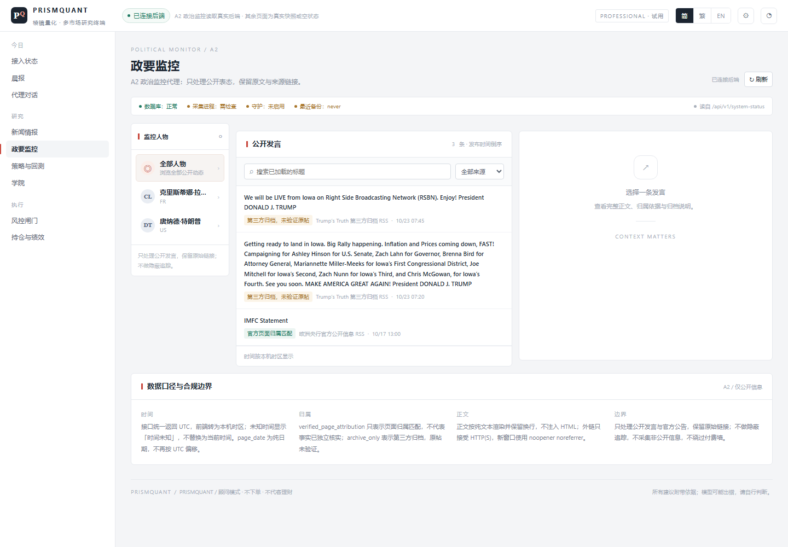
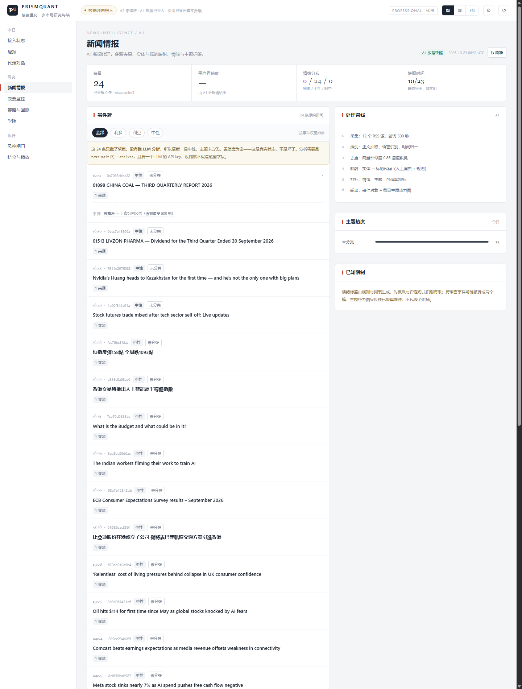

# PrismQuant · 棱鏡量化 — 前端

**繁體中文** · [English](README.en.md)

**PrismQuant** 是一個多市場、中低頻率的量化研究與多智能體決策平台的前端。

課程：**ITE4116M Final Year Project · Systems Development and Administration**，
IVE / HKIIT，Group 1。

它把五個專業代理（新聞、政治監控、執行、風控、指揮官）的產出，收斂成一份
訂閱者十分鐘讀得完、三次點擊就能行動的晨報。

> **這一版只顯示真實數據。** 沒有接上的模組顯示空狀態並說明缺什麼，不放任何為了好看
> 而編造的淨值、持倉、限額或新聞。上一版那些數字已經全部刪除。

> **只做顧問，不下單。** 實盤下單預設關閉，示範環境用模擬撮合。

> 註：產品的介面語言是簡體中文（與組員的 `/monitor/` 模組一致），但支援
> `简 / 繁 / EN` 三語切換。本文件用繁體，是因為這份文件給人看，不是產品的一部分。

---

## 截圖

**接入狀態（首頁）** — 五個代理各自接了什麼、缺什麼，一頁看完。



| 政要監控 · 已連線真後端 | 新聞情報 · 真實快照（24 條） |
|---|---|
|  |  |

其餘在 [`screenshots/`](screenshots)：空狀態、登入頁、手機版、繁體。

> 這兩張是**本機實跑**的結果，不是 GitHub Pages 上的樣子。
> 線上版沒有 `127.0.0.1` 的後端，政要監控會是空狀態；`data/news.json` 有 commit 上去，
> 所以新聞情報在線上也能看到那 24 條。

## 八個模組

| 模組 | 代理 | 內容 |
|---|---|---|
| 晨報 | A5 | 四格指標、晨報正文、四張執行意圖、隔夜時間線、代理狀態、風控摘要、分歧意見 |
| 新聞情報 | A1 | 事件簇（不是新聞流）、去重率、情緒與主題標籤、來源、處理管線、已知限制 |
| 政要監控 | A2 | 人物 → 發言 → 全文，歸屬標籤、採集狀態。**接真實後端。** |
| 策略與回測 | A3 | 淨值對基準、回撤、月度收益、策略家族、參數、收益歸因 |
| 風控閘門 | A4 | 閘門鏈路、六條限額與使用率、否決紀錄、一鍵暫停／緊急平倉 |
| 代理對話 | A5 | 對話與可展開的證據鏈、本次 run 資訊、引用來源 |
| 持倉與績效 | F-09 | 持倉、盈虧、市場暴露、按代理拆分的貢獻 |
| 學院 | — | 四篇教育文章 |

另外還有：登入頁與方案配額、`简 / 繁 / EN` 切換、響應式版面
（390 / 820 / 1180 / 1400 四個斷點）、鍵盤焦點框、PWA manifest。

---

## 怎麼做的

```
                    ┌──────────────────────────────┐
  index.html  ────► │  外殼（topbar、導航）          │
  （單一檔案）        │  hash 路由  #/briefing …      │
                    ├──────────────────────────────┤
                    │  view*() → 回傳 HTML 字串     │
                    │  render() 換掉 #view          │
                    ├──────────────────────────────┤
                    │  資料層                       │
                    │   D      快照 data/*.json      │
                    │   A2     真實 fetch client ───┼──► FastAPI  /api/v1/*
                    └──────────────────────────────┘
```

**一個檔案，不用建置。** 整個前端就是 `index.html`：標記、CSS、ES2020 全在一個文件裡。
沒有打包器、沒有框架、沒有執行期依賴、沒有 CDN、沒有外部字型——`file://` 直接開能跑，
丟到任何靜態主機也能跑。

**渲染方式。** hash 路由把 `#/route` 對到一個回傳 HTML 字串的 `view*()`，
`render()` 換掉 `#view` 的內容。狀態就幾個模組層級的物件（`A2` 管 API、
`STRAT` / `NEWS_FILTER` / `ACAD` 管各頁狀態）。互動靠 `document` 上一個委派的 click。

**圖表是手寫 SVG。** `navSvg()`、`ddSvg()`、`heatSvg()` 自己算座標，所以幾何可測、
執行期不載入任何東西。淨值、回撤、Sharpe、波動率全部由同一條序列算出（`statsOf()`），
所以它們不可能互相矛盾。

**API client** 完全對齊 A2 後端 `FRONTEND_INTEGRATION.md` 的契約：游標當不透明字串、
`order=published_desc`、切換人物時用遞增 `reqId` 作廢舊請求、404 / 422 / 503 各自對應
不同文案、`body_text` 以純文字渲染並保留換行。

**三語。** 簡體與英文是兩份字典；繁體不是第三份——它是執行期用 OpenCC（`s2hk`）產生的
對照表轉出來的：294 個單字 + 64 個詞組，專門處理「干預 / 乾淨 / 幹部」這種一對多。
`MutationObserver` 掛在 `body` 上，文字節點與 `placeholder / title / aria-label` 都在
插入時轉換，所以動態內容（載入更多、聊天回覆、toast）也覆蓋到，連資料內容一起轉——
不會出現「介面繁體、內容簡體」。

**字級只有七級**（26 / 22 / 18 / 15 / 13 / 12 / 11 / 10）。任何元素都不准落在級與級之間；
中文正文限寬 `40em`（約 33–38 字／行）。

**PWA。** `manifest.webmanifest` + `sw.js`（network-first，所以重新部署下一次載入就生效）。
可安裝、可離線開殼，但只限 `http(s)`。

---

## 怎麼跑

### 只是想看
雙擊 `index.html`。介面會完整渲染；接上數據的頁面（政要監控、新聞情報）顯示真數據，
還沒接上的顯示空狀態並寫清楚缺什麼。

因為是 `file://`，瀏覽器會擋掉 `fetch`，所以**兩個來源都讀不到**——
要看到數據就用 `start-frontend.cmd` 或 `tools/api_server.py`（下面有）。

### 要接真實的政要監控 API
先起 A2 服務（另一個 FastAPI 專案），把這個來源加進白名單，然後重啟 API：

```dotenv
PQ_CORS_ORIGINS='["http://localhost:5173"]'
```

雙擊 `start-frontend.cmd`——它會在 5173 起一個靜態伺服器、開瀏覽器，
並把客戶端指向 `http://127.0.0.1:8000`。

### 掛進 API 底下（同源，不用 CORS）
把 `index.html` 複製到後端 `web/index.html`，然後在 `app/main.py` 加：

```python
application.mount("/app", StaticFiles(directory=PROJECT_ROOT / "web", html=True), name="app")
```

開 `http://127.0.0.1:8000/app/`。

### GitHub Pages
這個 repo 已經開好 Pages，網址是
**https://user139930.github.io/prismquant-web/**

---

## 接上 A1 / A3（快照方式）

A1 與 A3 沒有 HTTP 介面，但它們的資料可以匯出成 JSON，前端直接讀：

```bash
# 0. 先採集一次（在 news-main 裡；這一步會真的去抓 RSS）
python -m src.rss_pipeline --limit-per-source 12 --max-age-days 10

# 1. 看資料庫裡有什麼（只印結構，不改任何東西）
python tools/export.py news --db "C://...//news-main//data//news.sqlite3" --report

# 2. 匯出新聞（--per-source 2 = 每個來源最多 2 條，避免整頁都是同一個來源）
python tools/export.py news --db "C://...//news-main//data//news.sqlite3" \
    --limit 24 --per-source 2 --out data/news.json

# 3. 匯出回測曲線（ndxbots 跑完會產生 curve.csv）
python tools/export.py backtest --curve "C://...//ndxbots//out//curve.csv" --out data/backtests.json
```

`--per-source` 是必要的：HKEX 披露易一次能丟幾百條公告，不設上限的話
整頁會被同一個來源吃光。

放進 `data/` 後重新整理，新聞頁會顯示「A1 数据快照」並附生成時間。
**沒有這兩個檔案時，前端顯示空狀態，不會壞。**

為什麼用快照而不是即時：GitHub Pages 是純靜態，跑不了 Python。快照讓線上版也能顯示
真數據，代價是要手動更新一次。要即時，就得由 A1 / A3 自己開 HTTP 端點。

### 選項 B：本機 API（即時，不用匯出）

如果檔案就在你要示範的那台機器上，跑這一行就好：

```bash
python tools/api_server.py --news-db "<...>\news.sqlite3" --curve "<...>\curve.csv"
# 打開 http://localhost:8020/
```

它同時做三件事：

1. 把前端跑起來（靜態伺服器）
2. 把 `/data/news.json`、`/data/backtests.json` **動態生成**——每次請求都重讀資料庫／CSV
3. 開兩個正式端點：`GET /api/v1/news/events?limit=60`、`GET /api/v1/strategy/backtests`

**前端一行都不用改**，打開就是真數據，按刷新就是最新。**零依賴**，只用 Python 標準庫，
不用裝 FastAPI。

前提：資料庫和 CSV 必須在跑這個 server 的那台機器上。

**刷新行為**

| 頁面 | 按右上角「刷新」會做什麼 |
|---|---|
| 新聞情報 / 策略與回測 | 重新抓一次 `data/*.json`（帶破快取參數）。檔案換了就提示「已更新到 …」，沒換就提示「沒有新數據」 |
| 政要監控 | 重新讀取 `/api/v1/people`、`public-records`、`system-status`；另外每 60 秒自動重讀一次（分頁隱藏時暫停） |
| 其他頁面 | 重新渲染（沒有資料來源的頁面不會變） |

注意「刷新」只能重新抓**已經存在**的資料。A1 / A3 的資料要變新，仍然要有人重新匯出
並 commit —— 這是靜態網站的先天限制，不是按鈕的問題。

## 每一頁顯示什麼

| 頁面 | 資料來源 | 沒有資料時 |
|---|---|---|
| 接入狀態 | 五個代理的接入判斷（不是文案，是執行期狀態） | — |
| 晨報 | A5 的一次 run（含四張意圖） | 空狀態 + 缺什麼 |
| 新聞情報 | `data/news.json`（已匯入 24 條）或 `tools/api_server.py` | 空狀態 + 匯出指令 |
| 政要監控 | A2 `/api/v1/*` **實時讀取** | 空狀態（不內置示例發言） |
| 策略與回測 | `data/backtests.json` | 空狀態 + 匯出指令 |
| 風控閘門 | A4 風控引擎 | 永遠空狀態（A4 無代碼） |
| 代理對話 | A5 對話接口 | 永遠空狀態（A5 無代碼） |
| 持倉與績效 | 模擬帳戶 / 券商沙盒 | 空狀態 |
| 學院 | 四篇文章（產品內容，不是數據） | — |

「空狀態」不是一片空白，是一張表：**需要什麼 / 誰提供 / 現狀**。

## 本機實跑記錄（2026-10-23）

政要監控這一頁不是示意，是當天真跑出來的：

| 步驟 | 結果 |
|---|---|
| PostgreSQL 18 建叢集 | `prismquant_political`，9 張表，alembic 升到 `0008_history_import` |
| 種子 | 2 位人物（拉加德、特朗普）、2 個來源（ECB 新聞 RSS、Trump's Truth 歸檔 RSS） |
| 採集 | 實際抓取並寫入：ECB「IMFC Statement」（官方頁面歸屬）、2 條 Trump 歸檔貼文 |
| API | `python -X utf8 -m app` 跑在 `:8000`，`/health`、`/people`、`/public-records` 全部 200 |
| 前端 | 從 `localhost:5173` 加 `?api=http://127.0.0.1:8000` 連上，畫面上就是這三條 |

**注意**：GitHub Pages 上連不到 `127.0.0.1:8000`，所以線上版這一頁仍是空狀態。
要看到上面那張截圖，必須在本機同時開著 PostgreSQL 與 API。

新聞情報這一頁同樣是真的抓來的：

| 步驟 | 結果 |
|---|---|
| 環境 | `news-main` 建 `.venv`，裝 `feedparser 6.0.14` / `streamlit 1.66.1` |
| 採集 | `python -m src.rss_pipeline --limit-per-source 12 --max-age-days 10` → 抓到 190 篇（19 新增、172 重複、3 個來源失敗） |
| 匯出 | `tools/export.py news --limit 24 --per-source 2` → `data/news.json`，17.6 KB，24 條 |
| 來源 | 16 個：披露易、CNBC（Top News / Earnings / Economy）、香港電台、BBC、Financial Times、ECB、HKEX、EIA、UBS CIO、State Street、Apollo、金管局、FINRA、Apple Newsroom |
| 前端 | 打開就顯示這 24 條，頁首標「A1 数据快照 · 已分析 0 条」 |

**「已分析 0 条」是正確的，不是 bug。** 標題是真的，但情緒 / 主題 / 命中股票
要跑 LLM 分析才有，而分析需要 API key（`news-main` 的 `--analyze`）。
沒有 key 的話，所有條目就是中性、無主題——這一版刻意不假造它們。

## 已知不足

1. **九頁裡有三頁仍然空的**：A3 要回測（缺五分鐘數據與額度）、A4 與 A5 沒有可運行的
   程式碼。A1 與 A2 已在本機跑通（見上一節），但 A2 只在開著後端的那台機器上成立。
2. **A1 的新聞有標題、沒分析。** 情緒、主題、命中股票要靠 LLM；沒有 API key 就是
   「已分析 0 条」。導出路徑已備好（`tools/export.py`、`tools/api_server.py`）。
2b. **A3 的回測跑不出來。** 它需要原生五分鐘 K 線，而 Futu OpenD 的
   `get_history_kl_quota` 只剩約 299 次，額度不足以支撐一次完整回測。
3. **沒有身份驗證。** 登入、配額、訂閱方案都是展示性的；沒有 session、沒有 token、
   沒有權限檢查。
4. **圖表沒有 hover 互動**——沒有 tooltip、沒有十字準線、不能縮放。
5. **無障礙只做了一半。** 地標、`aria-pressed`、可見焦點框、每個風險狀態都有文字標籤；
   但表格缺 `scope`，`prefers-reduced-motion` 沒處理。
6. **PWA 是最小可用**——可安裝、可離線，但沒有背景同步與推播。
7. **繁中轉換綁定現有文案。** 詞組表是從目前這份文案生成的；新文案若含一對多字
   （后／後、发／髮）可能轉錯，要重跑一次生成。
8. **i18n 只覆蓋介面，不覆蓋資料。** 新聞標題與文章正文保留原文語言——這對研究終端
   是正常做法，但確實意味著英文介面下仍會看到中文內容。

---

## 未來優化

**第一階段——把鏈路接起來（本學期）**
- A1 目前是「快照 + 本機 API」兩條路，都已經能用；下一步是讓 A1 自己在
  Streamlit 旁邊常駐一個 `/api/v1/news/events`，就不用匯出、也不用開 `api_server.py`。
- A3 開 `/api/v1/strategy/backtests`（前提是拿到五分鐘 K 線額度）。
- A2 已接上真實 PostgreSQL 並跑通；剩下的是把它部署到一台常開的機器，
  線上版才會脫離空狀態。
- 把指揮官目前的規則式回覆換成真的編排端點（`POST /api/v1/commander/run`），
  證據鏈的呈現方式不用改。

**第二階段——產品化**
- 基於 session 的登入、方案權限、由 API 餵的配額計數。
- 警示：站內抽屜、Email、Telegram，按方案分流。
- 圖表互動：十字準線、tooltip、區間選擇、匯出 CSV。
- 晨報與風控事件用 SSE 即時推送（契約原本就排除了只靠 WebSocket 的設計）。

**第三階段——工程**
- 把單檔拆成 ES module，**只在**檔案大到維護不了時才加建置步驟
  （現在 150 KB，還不算問題）。
- 自動化瀏覽器測試：路由冒煙測試、i18n 快照、a11y 斷言。
- 把設計 token 收進 CSS 自訂屬性，用同一組變數生成深色主題。
- 把 OpenCC 的轉換搬到建置期，不再把對照表 commit 進 repo。

**刻意不做**
- 高頻、訂單簿相關的視圖——企劃書已列為範圍外。
- 原生 iOS / Android——這個階段 PWA 已能滿足需求。

---

## 目錄結構

```
.
├── index.html              整個前端（由 src/ 生成，不要直接改這個）
├── manifest.webmanifest    PWA 設定
├── sw.js                   service worker（network-first）
├── icon.svg                App 圖示（用 SVG，所以仍是純文字檔）
├── start-frontend.cmd      本機預覽伺服器（Windows）
├── docs/
│   ├── DESIGN.zh.md        設計規格——資訊架構、字級、i18n、狀態處理
│   └── INTEGRATION.zh.md   整合說明——CORS、掛載、資料來源
├── screenshots/            桌面、手機、三種語言
├── data/                   快照放這裡（news.json 已匯入；沒有就顯示空狀態）
├── tools/pqdata.py         讀 A1 SQLite / A3 CSV 的共用讀取層
├── tools/export.py         A1 / A3 資料匯出腳本
├── tools/api_server.py      零依賴本機伺服器：靜態檔 + 動態 /data + /api/v1
└── src/
    ├── build.py            把 p*.html / p*.js 合成 index.html
    ├── p1_head.html        head + 設計 token + 全部 CSS
    ├── p2_body.html        靜態外殼 + 登入頁
    ├── p0_hant.js          繁簡對照表（OpenCC s2hk 生成）
    ├── p3_data.js          i18n 字典、輔助函式、快照載入
    ├── p4a_views.js        圖表、晨報、新聞
    ├── p4b_*.js            政要監控（真實 API）、策略
    ├── p4c_*.js            風控、對話、持倉、學院
    ├── p5_boot.js          外殼渲染、路由、API client、事件、啟動
    └── stub_api.py         整合測試用的契約 stub
```

改完 `src/` 之後重建：

```bash
python src/build.py            # 重建 + 全部路由截圖
python src/build.py briefing   # 重建 + 只截一頁
```

`build.py` 會對每個 script 區塊跑 `node --check`，語法錯就直接報錯停下——
這是專案裡唯一的「測試」，但它抓到的蟲比任何其他工具都多。

---

## 團隊

ITE4116M Group 1

| 姓名 | 學號 | 在這個 repo 的角色 |
|---|---|---|
| LIU Tsz Ho | 250139930 | 前端架構、實作、API 整合 |
| XU Yijia | 250050253 | 平台與風控；A2 後端 |
| AU Ka Chai | 250111797 | 專案管理；A5 指揮官 |
| XU Jinrong | 250500730 | 量化與策略；A3 執行 |

政要監控的服務（`/api/v1/*`）是 XU Yijia 的作品，放在另一個 repo。
這個 repo 只有網頁前端。
