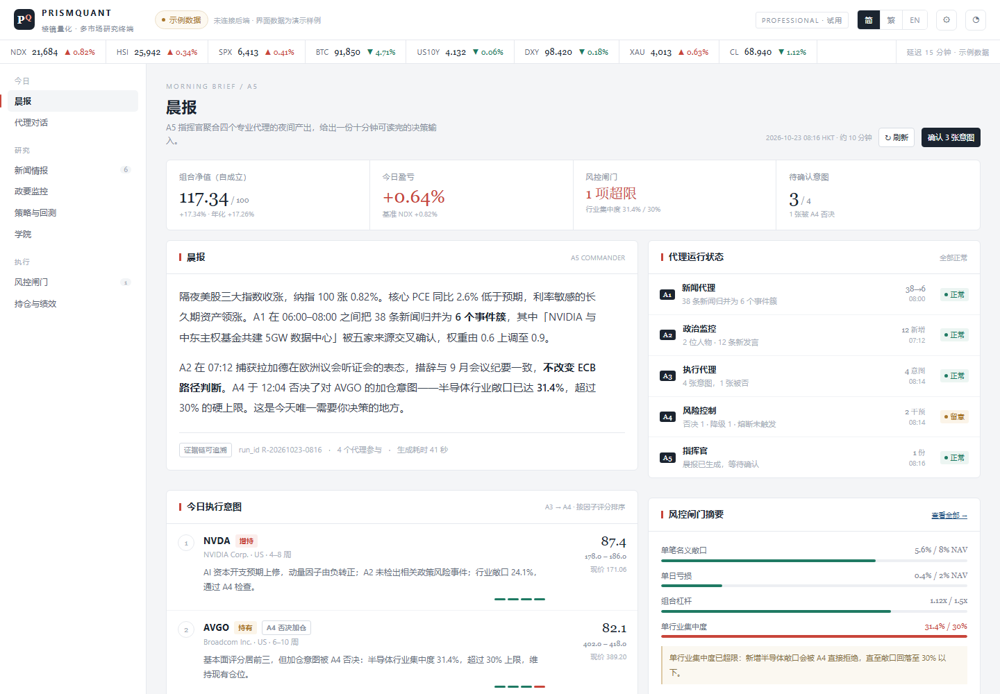
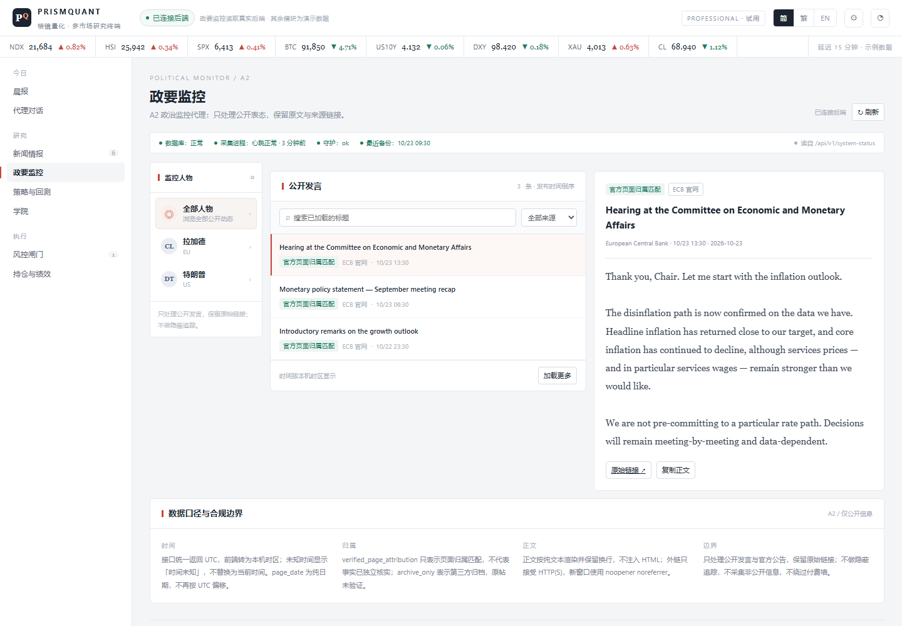
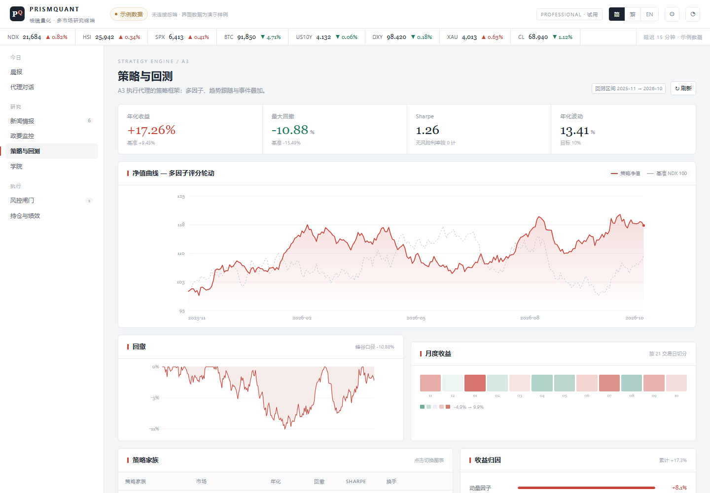
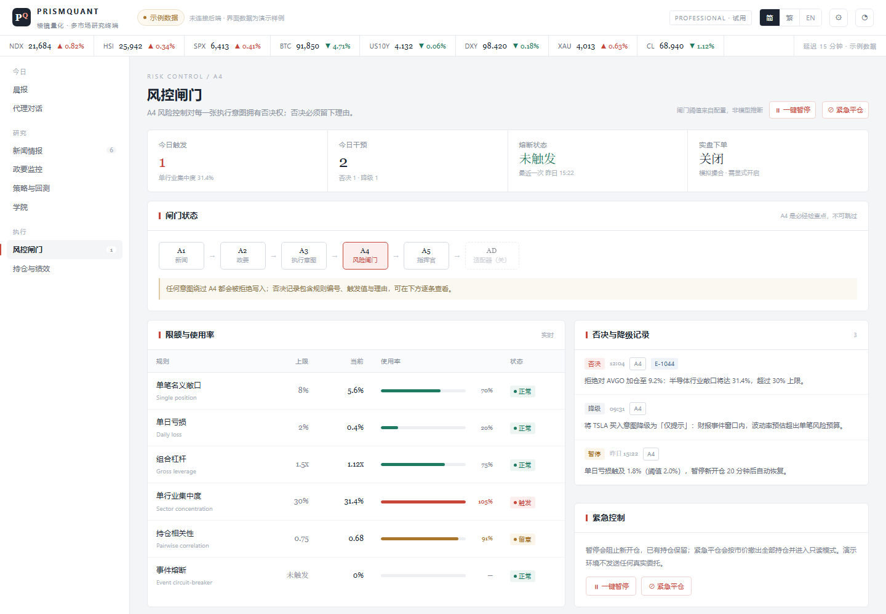

# PrismQuant · 棱鏡量化 — 前端

[English](README.md) · **繁體中文**

**PrismQuant** 是一個多市場、中低頻率的量化研究與多智能體決策平台的前端。

課程：**ITE4116M Final Year Project · Systems Development and Administration**，
IVE / HKIIT，Group 1。

它把五個專業代理（新聞、政治監控、執行、風控、指揮官）的產出，收斂成一份
訂閱者十分鐘讀得完、三次點擊就能行動的晨報。

> **只做顧問，不下單。** 實盤下單預設關閉，示範環境用模擬撮合。

> 註：產品的介面語言是簡體中文（與組員的 `/monitor/` 模組一致），但支援
> `简 / 繁 / EN` 三語切換。本文件用繁體，是因為這份文件給人看，不是產品的一部分。

---

## 截圖

| 晨報 | 政要監控（已接真實 API） |
|---|---|
|  |  |

| 策略與回測 | 風控閘門 |
|---|---|
|  |  |

其餘在 [`screenshots/`](screenshots)——桌面、手機、三種語言都有。

---

## 八個模組

| 模組 | 代理 | 內容 |
|---|---|---|
| 晨報 | A5 | 四格指標、晨報正文、四張執行意圖、隔夜時間線、代理狀態、風控摘要、分歧意見 |
| 新聞情報 | A1 | 事件簇（不是新聞流）、去重率、情緒與主題標籤、來源、處理管線、已知限制 |
| 政要監控 | A2 | 人物 → 發言 → 全文，歸屬標籤、採集狀態。**接真實後端。** |
| 策略與回測 | A3 | 淨值對基準、回撤、月度收益、策略家族、參數、收益歸因 |
| 風控閘門 | A4 | 閘門鏈路、六條限額與使用率、否決紀錄、一鍵暫停／緊急平倉 |
| 代理對話 | A5 | 對話與可展開的證據鏈、本次 run 資訊、引用來源 |
| 持倉與績效 | F-09 | 持倉、盈虧、市場暴露、按代理拆分的貢獻 |
| 學院 | — | 四篇教育文章 |

另外還有：登入頁與方案配額、`简 / 繁 / EN` 切換、響應式版面
（390 / 820 / 1180 / 1400 四個斷點）、鍵盤焦點框、PWA manifest。

---

## 怎麼做的

```
                    ┌──────────────────────────────┐
  index.html  ────► │  外殼（topbar、導航）          │
  （單一檔案）        │  hash 路由  #/briefing …      │
                    ├──────────────────────────────┤
                    │  view*() → 回傳 HTML 字串     │
                    │  render() 換掉 #view          │
                    ├──────────────────────────────┤
                    │  資料層                       │
                    │   D      示例數據             │
                    │   A2     真實 fetch client ───┼──► FastAPI  /api/v1/*
                    └──────────────────────────────┘
```

**一個檔案，不用建置。** 整個前端就是 `index.html`：標記、CSS、ES2020 全在一個文件裡。
沒有打包器、沒有框架、沒有執行期依賴、沒有 CDN、沒有外部字型——`file://` 直接開能跑，
丟到任何靜態主機也能跑。

**渲染方式。** hash 路由把 `#/route` 對到一個回傳 HTML 字串的 `view*()`，
`render()` 換掉 `#view` 的內容。狀態就幾個模組層級的物件（`A2` 管 API、
`STRAT` / `NEWS_FILTER` / `ACAD` 管各頁狀態）。互動靠 `document` 上一個委派的 click。

**圖表是手寫 SVG。** `navSvg()`、`ddSvg()`、`heatSvg()` 自己算座標，所以幾何可測、
執行期不載入任何東西。淨值、回撤、Sharpe、波動率全部由同一條序列算出（`statsOf()`），
所以它們不可能互相矛盾。

**API client** 完全對齊 A2 後端 `FRONTEND_INTEGRATION.md` 的契約：游標當不透明字串、
`order=published_desc`、切換人物時用遞增 `reqId` 作廢舊請求、404 / 422 / 503 各自對應
不同文案、`body_text` 以純文字渲染並保留換行。

**三語。** 簡體與英文是兩份字典；繁體不是第三份——它是執行期用 OpenCC（`s2hk`）產生的
對照表轉出來的：294 個單字 + 64 個詞組，專門處理「干預 / 乾淨 / 幹部」這種一對多。
`MutationObserver` 掛在 `body` 上，文字節點與 `placeholder / title / aria-label` 都在
插入時轉換，所以動態內容（載入更多、聊天回覆、toast）也覆蓋到，連資料內容一起轉——
不會出現「介面繁體、內容簡體」。

**字級只有七級**（26 / 22 / 18 / 15 / 13 / 12 / 11 / 10）。任何元素都不准落在級與級之間；
中文正文限寬 `40em`（約 33–38 字／行）。

**PWA。** `manifest.webmanifest` + `sw.js`（network-first，所以重新部署下一次載入就生效）。
可安裝、可離線開殼，但只限 `http(s)`。

---

## 怎麼跑

### 只是想看
雙擊 `index.html`。全部都會渲染，用的是示例數據，頁首會標示。

### 要接真實的政要監控 API
先起 A2 服務（另一個 FastAPI 專案），把這個來源加進白名單，然後重啟 API：

```dotenv
PQ_CORS_ORIGINS='["http://localhost:5173"]'
```

雙擊 `start-frontend.cmd`——它會在 5173 起一個靜態伺服器、開瀏覽器，
並把客戶端指向 `http://127.0.0.1:8000`。

### 掛進 API 底下（同源，不用 CORS）
把 `index.html` 複製到後端 `web/index.html`，然後在 `app/main.py` 加：

```python
application.mount("/app", StaticFiles(directory=PROJECT_ROOT / "web", html=True), name="app")
```

開 `http://127.0.0.1:8000/app/`。

### GitHub Pages
這個 repo 已經開好 Pages，網址是
**https://user139930.github.io/prismquant-web/**

---

## 哪些是真的

講清楚，因為示範時這件事會被問。

| 部分 | 狀態 |
|---|---|
| 全部介面邏輯——路由、篩選、游標分頁、取消請求、錯誤狀態、i18n、響應式 | **真的** |
| 政要監控——`/health`、`/api/v1/system-status`、`/api/v1/people`、`/api/v1/public-records`、`/api/v1/public-records/{id}` | **真實整合**，完全照契約。需要 A2 後端與它的 PostgreSQL 在跑。 |
| 晨報、新聞、策略、風控、持倉、對話的內容 | **示例數據**。數字由固定種子生成，內部自洽，但**不是真實回測**。 |
| 登入 | 純展示——任意密碼可進，不做任何驗證。 |

A1（新聞）是 Streamlit 應用、A3（策略）是 CLI，兩者都沒有 HTTP 介面，
所以前端目前呼叫不到。

---

## 已知不足

1. **A1 與 A3 沒有 HTTP API。** 這兩個模組跑示例數據是設計上的取捨，不是漏做。
   修在服務側：開一個唯讀端點，然後把 `D` 換成 `fetch`，畫面不用改。
2. **A2 的整合只用契約 stub 驗過，沒接過正式資料庫。** stub（`src/stub_api.py`）
   照文件回應格式寫；真正的資料庫在開發機上一直沒有連通過。
3. **沒有身份驗證。** 登入、配額、訂閱方案都是展示性的；沒有 session、沒有 token、
   沒有權限檢查。
4. **圖表沒有 hover 互動**——沒有 tooltip、沒有十字準線、不能縮放。
5. **無障礙只做了一半。** 地標、`aria-pressed`、可見焦點框、每個風險狀態都有文字標籤；
   但表格缺 `scope`，`prefers-reduced-motion` 沒處理。
6. **PWA 是最小可用**——可安裝、可離線，但沒有背景同步與推播。
7. **繁中轉換綁定現有文案。** 詞組表是從目前這份文案生成的；新文案若含一對多字
   （后／後、发／髮）可能轉錯，要重跑一次生成。
8. **i18n 只覆蓋介面，不覆蓋資料。** 新聞標題與文章正文保留原文語言——這對研究終端
   是正常做法，但確實意味著英文介面下仍會看到中文內容。

---

## 未來優化

**第一階段——把鏈路接起來（本學期）**
- A1 開 `/api/v1/news/events`、A3 開 `/api/v1/strategy/backtests`，
  把 `viewNews()` 與 `viewStrategy()` 裡的 `D` 換成 `fetch`。
- 把 A2 的 PostgreSQL 起起來，照整合清單重跑一次驗收。
- 把指揮官目前的規則式回覆換成真的編排端點（`POST /api/v1/commander/run`），
  證據鏈的呈現方式不用改。

**第二階段——產品化**
- 基於 session 的登入、方案權限、由 API 餵的配額計數。
- 警示：站內抽屜、Email、Telegram，按方案分流。
- 圖表互動：十字準線、tooltip、區間選擇、匯出 CSV。
- 晨報與風控事件用 SSE 即時推送（契約原本就排除了只靠 WebSocket 的設計）。

**第三階段——工程**
- 把單檔拆成 ES module，**只在**檔案大到維護不了時才加建置步驟
  （現在 150 KB，還不算問題）。
- 自動化瀏覽器測試：路由冒煙測試、i18n 快照、a11y 斷言。
- 把設計 token 收進 CSS 自訂屬性，用同一組變數生成深色主題。
- 把 OpenCC 的轉換搬到建置期，不再把對照表 commit 進 repo。

**刻意不做**
- 高頻、訂單簿相關的視圖——企劃書已列為範圍外。
- 原生 iOS / Android——這個階段 PWA 已能滿足需求。

---

## 目錄結構

```
.
├── index.html              整個前端（由 src/ 生成，不要直接改這個）
├── manifest.webmanifest    PWA 設定
├── sw.js                   service worker（network-first）
├── icon.svg                App 圖示（用 SVG，所以仍是純文字檔）
├── start-frontend.cmd      本機預覽伺服器（Windows）
├── docs/
│   ├── DESIGN.zh.md        設計規格——資訊架構、字級、i18n、狀態處理
│   └── INTEGRATION.zh.md   整合說明——CORS、掛載、資料來源
├── screenshots/            桌面、手機、三種語言
└── src/
    ├── build.py            把 p*.html / p*.js 合成 index.html
    ├── p1_head.html        head + 設計 token + 全部 CSS
    ├── p2_body.html        靜態外殼 + 登入頁
    ├── p0_hant.js          繁簡對照表（OpenCC s2hk 生成）
    ├── p3_data.js          i18n 字典、輔助函式、示例數據
    ├── p4a_views.js        圖表、晨報、新聞
    ├── p4b_*.js            政要監控（真實 API）、策略
    ├── p4c_*.js            風控、對話、持倉、學院
    ├── p5_boot.js          外殼渲染、路由、API client、事件、啟動
    └── stub_api.py         整合測試用的契約 stub
```

改完 `src/` 之後重建：

```bash
python src/build.py            # 重建 + 全部路由截圖
python src/build.py briefing   # 重建 + 只截一頁
```

`build.py` 會對每個 script 區塊跑 `node --check`，語法錯就直接報錯停下——
這是專案裡唯一的「測試」，但它抓到的蟲比任何其他工具都多。

---

## 團隊

ITE4116M Group 1

| 姓名 | 學號 | 在這個 repo 的角色 |
|---|---|---|
| LIU Tsz Ho | 250139930 | 前端架構、實作、API 整合 |
| XU Yijia | 250050253 | 平台與風控；A2 後端 |
| AU Ka Chai | 250111797 | 專案管理；A5 指揮官 |
| XU Jinrong | 250500730 | 量化與策略；A3 執行 |

政要監控的服務（`/api/v1/*`）是 XU Yijia 的作品，放在另一個 repo。
這個 repo 只有網頁前端。
